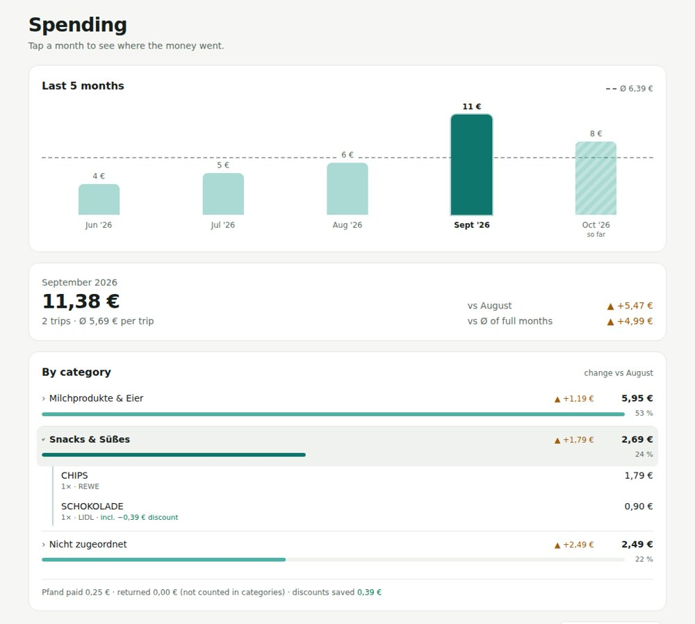
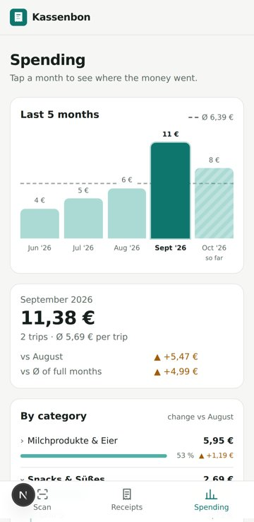

# Kassenbon web app

Take a photo of a supermarket receipt after shopping → Gemini reads it → you check it → it is saved to your
database. See where your money goes per month and per category. Works in any browser and installs on your
phone's home screen. Runs free on Vercel with a free Neon Postgres database.

<p>
  
  
</p>

| Page | What it does |
|------|--------------|
| **Scan** | *Take photo* (opens the phone camera) or *Upload photo or PDF*. Gemini extracts store, date, items, Pfand, discounts, total **and a category per product**. You can correct anything; the "lines add up to the total" check updates as you type. Duplicates are detected. |
| **Receipts** | Everything saved, grouped by month. Open one to see its lines and change categories, or delete it. **Export to Excel** downloads all receipts and lines. |
| **Spending** | The last 5 months as bars (with the average of the finished months). Tap a month: total, trips, change vs the previous month (the running month is compared with the same days of the month before), spending **by category**. Tap a category to see its products, with discounts counted against the product they belong to. Pfand is shown separately. |

**Categories learn from you.** When you change a product's category (while reviewing or later on the receipt
page), that choice is used automatically the next time the same product appears: from the same shop first,
otherwise from any shop. It is marked "remembered".

Only the Google accounts you list in `ALLOWED_EMAILS` can sign in; each account sees only its own receipts.

## How it works

```
Phone/browser ──photo──▶ /api/extract ──▶ Gemini (JSON incl. categories; retries on 503/429, fallback model)
      ▲                                         │
      └── editable review ◀── your remembered categories ◀── checks (sum = total, qty × price, date)
      │
      └──save──▶ /api/receipts ──▶ checks again ──▶ Postgres (one transaction: receipt + lines)
```

Gemini only reads; the arithmetic checks are plain code (`lib/validation.ts`). The API key, the database and
all Google calls stay on the server.

### Database

Tables are defined in `lib/db/schema.ts`; changes are SQL migrations in `drizzle/`, applied automatically before
each Vercel build (`scripts/migrate.mjs`).

| Table | One row per |
|-------|-------------|
| `users` | Google account |
| `stores` / `store_aliases` | shop chain ("LIDL") / name as printed ("LIDL DIENSTLEISTUNG GMBH & CO. KG") |
| `receipts` | receipt; amounts in **cents**; keeps Gemini's original answer in `raw_extraction` |
| `receipt_items` | line: product, Pfand, Leergut, discount…, with category and who chose it (`model` / `memory` / `user`) |
| `categories` | the 10 fixed categories (`lib/categories.ts`) |
| `category_memory` | your corrections: shop + printed product → category |

A year of weekly shopping is well under 1 MB, far below the free plan's limit.

## Deploy to Vercel (one-time setup)

You need a Google account, a [Vercel](https://vercel.com) account linked to GitHub, and a Gemini API key from
[Google AI Studio](https://aistudio.google.com/apikey).

### 1. Google sign-in (OAuth client)

1. [console.cloud.google.com](https://console.cloud.google.com) → create a project (e.g. "Kassenbon").
2. **APIs & Services → OAuth consent screen** (Google Auth Platform): **External**, app name and your email.
   Under **Audience → Test users**, add your Gmail address. Leaving the app in *Testing* is fine for personal use.
3. **APIs & Services → Credentials → Create credentials → OAuth client ID** → **Web application**.
4. **Authorized redirect URIs**: `https://<your-app>.vercel.app/api/auth/callback/google` (your fixed domain,
   see step 3.4) and `http://localhost:3000/api/auth/callback/google` for local development.
5. Copy the **Client ID** and **Client secret**.

### 2. Vercel project

1. [vercel.com/new](https://vercel.com/new) → import the `TxtExtract` GitHub repo.
2. **Root Directory: `web`**. If Vercel picks **Application Preset: Services**, change it to **Next.js**.
3. Add the **Environment Variables**:

   | Name | Value |
   |------|-------|
   | `GEMINI_API_KEY` | your Gemini key |
   | `GEMINI_MODEL` | `gemini-2.5-flash` (or the model you use) |
   | `GEMINI_FALLBACK_MODEL` | optional, e.g. `gemini-3.5-flash-lite` |
   | `GOOGLE_CLIENT_ID` / `GOOGLE_CLIENT_SECRET` | from step 1 |
   | `ALLOWED_EMAILS` | your Gmail address (comma-separate several) |
   | `NEXTAUTH_SECRET` | output of `openssl rand -base64 32` |
   | `NEXTAUTH_URL` | your fixed domain, e.g. `https://txtextract-web.vercel.app` (project → **Settings → Domains**) |

### 3. Database (Neon, free)

1. In the Vercel project: **Storage → Create Database → Neon** (Serverless Postgres) → free plan → region
   close to you (e.g. Frankfurt) → **Connect** it to the project. Vercel adds `DATABASE_URL` for you.
2. **Deployments → ⋯ → Redeploy**. The build creates the tables (`db:migrate: database is up to date.` in the
   build log).
3. Open the app on your phone → browser menu → **Add to Home Screen**.
4. Make sure `NEXTAUTH_URL` is your fixed domain and `<NEXTAUTH_URL>/api/auth/callback/google` is in the OAuth
   client (step 1.4). After changing environment variables, **Redeploy**.

Every push to the branch you deployed redeploys automatically and applies new migrations.

### Moving receipts from the old Google Sheet (one time)

If you used the earlier Google-Sheets version, copy those receipts into the database. On your computer:

```bash
cd web
npm install
# .env.local: DATABASE_URL (Vercel → Storage → your database → .env.local tab), GOOGLE_SHEET_ID,
#             GOOGLE_SERVICE_ACCOUNT_EMAIL, GOOGLE_PRIVATE_KEY, and GEMINI_API_KEY for --categorize
npm run import:sheets -- --email you@gmail.com --dry-run      # shows what would happen
npm run import:sheets -- --email you@gmail.com --categorize   # imports and lets Gemini categorise old products
```

It is safe to run again (receipts already imported are skipped) and ends by checking that the sheet total and
the database total match. The Google Sheets variables can be removed afterwards.

### Troubleshooting

| Message | Fix |
|---------|-----|
| "The database is not configured" | Connect the Neon database (step 3) and redeploy. |
| "This Google account is not allowed" | Add the address to `ALLOWED_EMAILS` and redeploy. |
| Google says `redirect_uri_mismatch` | Set `NEXTAUTH_URL` to your fixed domain, redeploy, and add exactly `<NEXTAUTH_URL>/api/auth/callback/google` to the OAuth client. Google's "error details" link shows the URI that was sent. |
| "Gemini is busy or rate-limited" | Google is overloaded; try again or set `GEMINI_FALLBACK_MODEL`. |
| "No usable Gemini model … not available (404)" | Google retired the model name; use the replacement the message suggests. |

## Local development

```bash
cd web
npm install
cp .env.example .env.local      # fill in, or use the no-setup switches below
npm run dev                     # http://localhost:3000
```

To work without any accounts, put these in `.env.local` (they are ignored in production builds):
`AUTH_DISABLED=1`, `GEMINI_FAKE=1`, `DATA_BACKEND=pglite` (a Postgres that runs inside the app; add
`PGLITE_DIR=.pglite` to keep its data between restarts).

```bash
npm run lint && npm run typecheck
npm test            # unit tests, incl. the database layer on a real (in-process) Postgres
npm run e2e         # browser tests on desktop and phone sizes (fake Gemini, in-process Postgres)
npm run db:generate # after editing lib/db/schema.ts: writes a new migration to drizzle/
```
